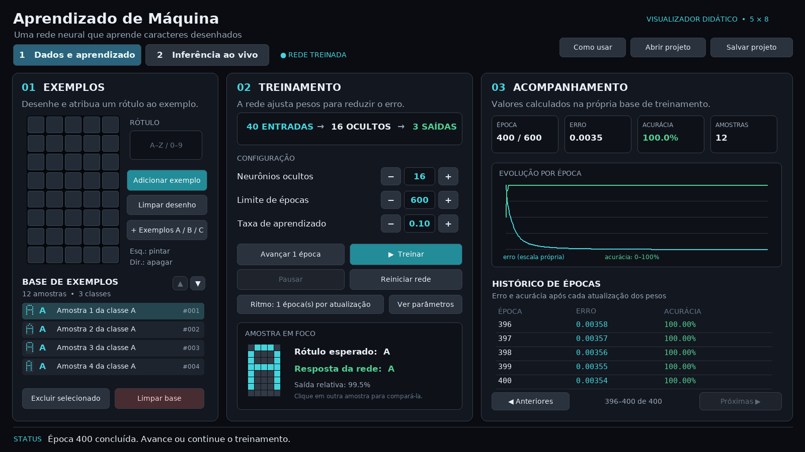
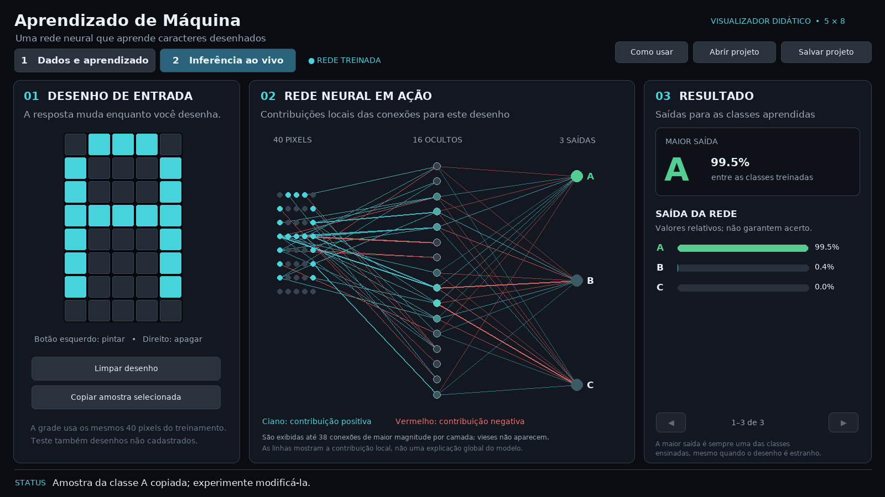

# Aprendizado de Máquina: reconhecedor de caracteres

Aplicação didática em **Python, Pygame e NumPy** para a disciplina de Introdução à Inteligência Artificial. Os alunos criam dados rotulados, acompanham o treinamento supervisionado de uma rede neural e testam o resultado em uma janela interativa.



## O que o programa faz

- Permite desenhar em uma matriz de **5 colunas × 8 linhas**, associar cada desenho a uma letra de **A a Z** ou a um dígito de **0 a 9** e cadastrar múltiplas amostras por classe.
- Inclui um conjunto de demonstração com 12 desenhos das letras A, B e C, que pode ser adicionado sem apagar a base atual.
- Treina uma rede neural real, implementada com NumPy: **40 entradas → camada oculta ReLU → saídas softmax**. Os pesos e vieses são ajustados por retropropagação e descida do gradiente em lote.
- Mostra época, erro, acurácia de treinamento, gráfico e histórico de todas as épocas. É possível percorrer o histórico e acompanhar a previsão de uma amostra escolhida.
- Permite avançar uma época por vez, treinar continuamente, pausar, reiniciar a rede e ajustar parâmetros e ritmo de atualização.
- Mostra todos os pesos e vieses atuais em uma janela paginada, que continua sendo atualizada enquanto a rede treina.
- Reconhece em tempo real os desenhos da etapa de inferência, mostra as saídas por classe e representa as contribuições de conexões reais da rede.
- Salva e abre projetos em JSON com exemplos, configuração, pesos, vieses e histórico. Não depende de servidor, nuvem ou serviço de IA.

A mesma matriz de 5 × 8 é utilizada nas duas etapas, pois a entrada de inferência deve ter o mesmo formato dos exemplos usados no treinamento.

## Executar no Windows

1. Instale o **Python 3.10, 3.11 ou 3.12**. Na instalação, marque a opção **“Add Python to PATH”**.
2. Extraia todo o conteúdo do ZIP para uma pasta.
3. Abra a pasta extraída e dê duplo clique em **`iniciar_windows.bat`**.
4. Na primeira execução, o iniciador cria um ambiente virtual e instala as bibliotecas. É preciso ter acesso à internet nessa primeira instalação. Nas próximas execuções, o programa funciona sem internet.

Se preferir executar pelo terminal do Windows, dentro da pasta extraída:

```powershell
py -3 -m venv .venv
.\.venv\Scripts\python.exe -m pip install -r requirements.txt
.\.venv\Scripts\python.exe app.py
```

Se `py` não estiver disponível, use `python` no lugar de `py -3`. Caso o iniciador indique erro de instalação, confira sua conexão e a versão do Python. No Windows, o seletor de arquivos usa o Tkinter, normalmente incluído na instalação oficial do Python.

## Executar no Linux ou macOS

É necessário Python 3.10 ou superior, um ambiente gráfico e o Tkinter instalado para abrir e salvar projetos.

```bash
python3 -m venv .venv
.venv/bin/python -m pip install -r requirements.txt
.venv/bin/python app.py
```

Em algumas distribuições Linux, pode ser necessário instalar separadamente os pacotes do sistema para `venv` e `tkinter`. O programa requer uma sessão gráfica; não é uma aplicação de terminal.

## Roteiro rápido de demonstração

1. Na aba **1 Dados e aprendizado**, clique em **+ Exemplos A / B / C**. A base conterá quatro desenhos de cada letra.
2. Clique em uma linha da base para escolher a **amostra em foco**.
3. Clique algumas vezes em **Avançar 1 época**. Observe o erro, a acurácia e a resposta à amostra selecionada.
4. Clique em **Ver parâmetros** para observar os pesos e vieses. Feche a janela de parâmetros para ajustar o ritmo ou pausar; ela também acompanha as mudanças enquanto o treinamento está em execução.
5. Clique em **Treinar**. Para acelerar, clique em **Ritmo** e escolha 10 ou 50 épocas por atualização visual. **Pausar** interrompe a execução; **Treinar** continua a partir dos pesos atuais. **Reiniciar rede** mantém os desenhos e reinicia os pesos e o histórico.
6. Abra **2 Inferência ao vivo**. Use **Copiar amostra selecionada** ou desenhe um caractere na matriz. A previsão e as conexões mudam à medida que o desenho é editado. Compare o comportamento com desenhos que não estão na base.
7. Use **Salvar projeto** para guardar os exemplos, os pesos e o histórico, ou **Abrir projeto** para retomá-los posteriormente.

## Cadastrar seus próprios exemplos

1. Pinte o desenho na grade da primeira aba com o **botão esquerdo** do mouse e apague células com o **botão direito**.
2. Clique no campo **RÓTULO** e digite uma letra ou um número; letras minúsculas são convertidas para maiúsculas.
3. Clique em **Adicionar exemplo**. O desenho é limpo e passa a aparecer na lista da base.
4. Repita o processo com variações da mesma classe e com outras classes. É necessário cadastrar **pelo menos duas classes diferentes** para treinar. É recomendável fornecer vários desenhos variados por classe.
5. Para selecionar um exemplo, clique nele na lista; use as setas ou a roda do mouse para percorrê-la. **Excluir selecionado** exclui a amostra selecionada. **Limpar base** solicita confirmação.

A base comporta até 2.000 amostras e 36 classes alfanuméricas. A interface alerta quando desenhos idênticos recebem rótulos diferentes, pois isso cria exemplos contraditórios. Alterar a base após o treinamento descarta a rede anterior: é necessário treinar novamente com a nova base. Alterar a quantidade de neurônios ocultos também reinicia a rede. Alterar a taxa ou o limite de épocas mantém os pesos já aprendidos.

## Entendendo os valores

- **Época**: uma passagem pelo conjunto completo de treinamento, seguida de uma atualização dos parâmetros. O método usado é gradiente descendente em lote: todas as amostras participam de cada atualização.
- **Erro**: entropia cruzada média das amostras de treinamento, calculada depois da atualização. Em geral, o objetivo é reduzi-la.
- **Acurácia**: percentual de acertos **na própria base de treinamento**, calculado depois da atualização. Uma acurácia alta nessa base não garante desempenho em desenhos novos.
- **Taxa de aprendizado**: tamanho do passo de atualização dos parâmetros. Valores maiores podem acelerar, mas também podem causar oscilações ou prejudicar o aprendizado.
- **Saídas em %**: valores da camada softmax relativos às classes treinadas. A maior saída é sempre uma dessas classes; mesmo um desenho estranho pode receber uma porcentagem alta. Não interprete esse número como garantia de acerto ou probabilidade calibrada.
- **Histórico**: registra os valores de cada época. O gráfico mostra a acurácia na escala de 0 a 100% e o erro em escala própria. As setas abaixo da tabela permitem percorrer todas as épocas.

## Como ler a visualização da rede



Cada um dos **40 círculos de entrada** corresponde a uma célula, lida por linhas da esquerda para a direita. Os círculos centrais mostram os neurônios ocultos e sua intensidade de ativação; os da direita representam as classes.

As linhas em destaque são os termos de maior magnitude para o desenho atual: na primeira camada, **valor do pixel × peso**; na segunda, **ativação do neurônio oculto × peso**. A cor **ciano** representa contribuição positiva para a soma de entrada do neurônio de destino e a **vermelha**, contribuição negativa. A espessura/intensidade indica a magnitude relativa dentro de cada camada. São mostradas até 38 conexões por camada, e os vieses não aparecem como linhas. Para mais de oito classes, use as setas para percorrer as saídas; a representação acompanha a página atual.

Essas linhas são uma visão local e simplificada do cálculo, não uma medida de importância global nem uma explicação causal do reconhecimento. O botão **Ver parâmetros** mostra os valores numéricos atuais de todos os pesos e vieses; `E` identifica o pixel de entrada, `H` o neurônio oculto e `b` um viés.

## Sugestões para discutir em sala

- Compare o início e o final do treinamento: o que mudou nos pesos, no erro e na previsão da amostra em foco?
- Cadastre poucas variações e teste uma letra parecida, mas inédita. Adicione esse exemplo e treine novamente. O que aconteceu?
- Experimente atribuir o mesmo desenho a duas classes: por que a base passa a conter informações conflitantes?
- Mude a taxa de aprendizado e o número de neurônios. O ajuste influencia o ritmo e o resultado?
- Compare uma amostra usada no treino com uma nova. Por que acertar os exemplos de treinamento não demonstra, por si só, boa generalização?

O programa não separa automaticamente conjuntos de validação e teste; seu objetivo é demonstrar o processo de treinamento e inferência, não avaliar um reconhecedor para uso real. Os resultados variam conforme os desenhos e a configuração.

## Arquivos do projeto

- `app.py`: inicia a aplicação.
- `interface.py`: interface, desenho, controles e visualizações.
- `modelo.py`: rede neural, propagação e treinamento.
- `dados.py`: exemplos, validação e gravação dos projetos.
- `requirements.txt`: dependências.
- `iniciar_windows.bat`: inicialização no Windows.
- `tests/`: verificações automatizadas do modelo, dos dados e da interface.
- `imagens/`: imagens ilustrativas da interface.

Para executar os testes na pasta do projeto:

```bash
python -m unittest discover -s tests -v
```

Em um Linux sem ambiente gráfico, os testes de interface podem usar `SDL_VIDEODRIVER=dummy`.
